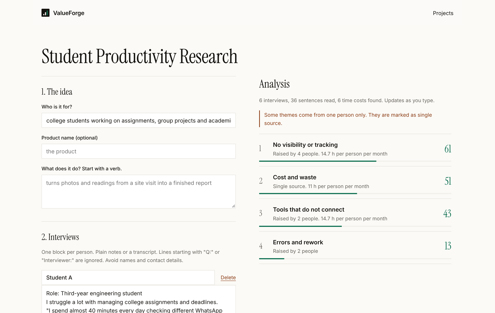
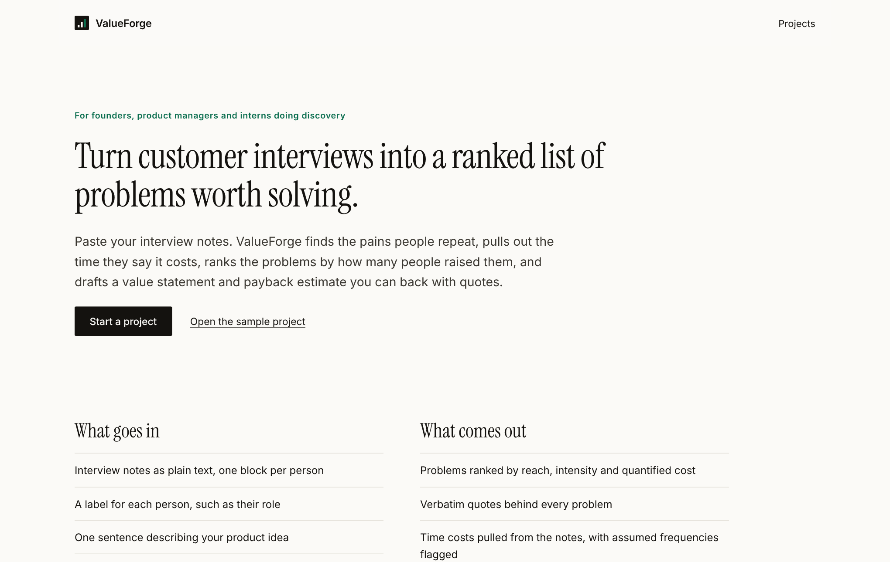
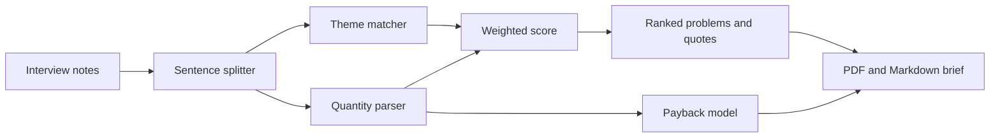

# ValueForge

**Turn customer interviews into a ranked problem list, a value statement and a payback estimate. Every claim traces to a quote.**

   

**Live demo: https://valueforge-tir3.onrender.com** 

(free tier, the first load can take about 30 seconds to wake)

Founders and product builders talk to customers, then guess which problem matters. ValueForge reads the interview notes and pulls out themes, how many people raised each one, pain intensity and the time costs people actually said out loud ("40 minutes", "6 reports a week"). It ranks the problems, shows verbatim quotes, builds a payback estimate and exports a PDF or Markdown brief.



<table>
<tr><td></td></tr>
<tr><td align="center">Home</td></tr>
</table>

## The problem

Customer interviews produce pages of notes and a gut feeling. The questions that decide what to build are harder: which problem did the most people raise, how much does it cost them, and what is solving it worth? A build decision made on the loudest anecdote is a guess. ValueForge makes the evidence countable and the quotes checkable.

## Try it in 30 seconds

1. Open the [live demo](https://valueforge-tir3.onrender.com) and choose **Projects**.
2. Load the sample project (4 interviews about inspection reporting).
3. Read the ranked problems, then edit a note and watch the analysis update as you type.
4. Open the payback panel, enter a cost per hour and build cost, and download the PDF brief.

## Tested on real interviews

The author interviewed **6 engineering students** about assignments, group projects, study material, interview prep and internship tracking, then ran the notes through ValueForge.

| Result | Value |
|---|---|
| Interviews analysed | 6 (36 sentences) |
| Time costs found and quantified | 6 of 6 |
| Average time lost per student | **14.1 hours a month** |
| Top problem | **No visibility or tracking**, raised by 4 of 6 students (score 61) |
| Then | Cost and waste (51, single source), Tools that do not connect (43), Errors and rework (13) |

Top evidence, verbatim: *"I spend around 90 minutes every day searching for coding questions, tracking my progress and deciding what topics to study next."*

The brief also warned that some themes came from one person only, and that six interviews are a set of hypotheses to test rather than a finding. The payback figure in the exported brief uses the author's own assumptions (a cost per hour, a build cost and a 50% reduction), so it is an illustration, not a forecast.

## What it does

- **Themes.** Finds errors and rework, manual and repetitive work, tools that do not connect, no visibility or tracking, and cost and waste.
- **Reach.** Counts how many different people raised each theme, and marks single-source themes.
- **Stated costs.** Understands "40 minutes every day", "twice a month", "another hour each time" and converts them to hours per person per month. Frequencies borrowed from a neighbouring sentence are marked as assumed.
- **Weighted score.** 40% reach, 30% pain intensity, 30% quantified cost. If nobody gave a cost, it becomes 55% reach and 45% intensity.
- **Payback model.** People affected, cost per hour, expected reduction and build cost give a monthly saving, a payback period and first-year net.
- **Next questions.** Suggests the follow-up question to ask for each top theme.
- **Brief.** A PDF or Markdown document with the value statement, ranked problems, verbatim quotes, payback estimate and method.
- **Guardrails.** Warns on fewer than 5 interviews, single-source themes and assumed frequencies.

## How it works



No language model is used. There is nothing to hallucinate, the same notes always give the same result, and every quote is copied from the notes.

## API

| Method | Path | Purpose |
|---|---|---|
| GET | `/healthz` | Health check |
| GET | `/api/projects` | List your projects |
| POST | `/api/projects` | Create a project |
| POST | `/api/projects/sample` | Create the sample project |
| GET | `/api/projects/:id` | Project, interviews and analysis |
| PATCH | `/api/projects/:id` | Update project and payback inputs |
| DELETE | `/api/projects/:id` | Delete a project |
| POST | `/api/projects/:id/interviews` | Add an interview |
| PATCH / DELETE | `/api/projects/:id/interviews/:iid` | Edit or remove an interview |
| GET | `/api/projects/:id/brief.md` | Download the Markdown brief |
| GET | `/api/projects/:id/brief.pdf` | Download the PDF brief |

## Project structure

```
server/
  analysis.js   themes, sentence splitter, quantity parser, scoring, payback model
  sample.js     4 labelled sample interviews
  brief.js      Markdown and PDF (pdfkit) brief
  db.js         SQLite storage and auto-purge
  index.js      Express routes, limits, security headers
web/            React 18 + Vite front end (minimalist UI, autosave, live analysis)
test/           14 automated tests (analysis logic and HTTP)
```

## Design decisions

- **Deterministic over generative.** For discovery work, a summary you cannot trace is worse than a rougher one you can.
- **Quotes, not paraphrase.** The brief shows what people said, so a reader can disagree with the ranking.
- **Say when the sample is small.** Six interviews can suggest a problem, not prove it. The tool says so.
- **Assumptions are labelled.** Frequencies it had to infer and payback inputs you typed are marked, never presented as findings.

## Run it locally

Needs Node 22.13 or newer (uses the built-in `node:sqlite`).

```bash
npm install
npm run dev                  # API on :3000, Vite dev server on :5173
npm test                     # 14 automated tests
npm run build && npm start   # production build, everything on :3000
```


## Privacy by design

No accounts and no cookies. Each browser gets a random ID in localStorage, sent as a header, and every project is scoped to it. Projects are deleted automatically after 60 days. The app asks users to avoid names and contact details in interview notes. Requests are rate limited and a strict Content-Security-Policy is set. The app has its own privacy and terms pages.

## Honest limits

- Pattern matching misses phrasing it does not know, and works on English notes.
- Six interviews are a signal, not a statistic.
- The payback estimate is only as good as the numbers you enter.

## Roadmap

- Import interview transcripts from files.
- Editable theme lexicon per project.
- Compare two rounds of interviews to see whether a problem is growing.

## Stack

Node 22, Express 4, `node:sqlite`, pdfkit, React 18, Vite, Motion, Lenis. About 1,300 lines of application code.

---

## 👩‍💻 Author

**Subhalaxmi Panda**  
Software Developer | AI/ML Enthusiast | Full-Stack Developer

I enjoy building practical software solutions, exploring emerging technologies, and turning ideas into scalable, user-focused applications.

### Connect with Me

<p align="left">
  <a href="https://github.com/SubhuPanda21">
    
  </a>
  <a href="https://www.linkedin.com/in/subhalaxmipanda">
    
  </a>
</p>

---

<p align="center">
  <b>Designed & Developed by Subhalaxmi Panda</b>
  <br>
  Building. Learning. Innovating.
</p>
