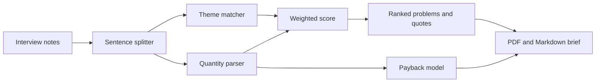

# ValueForge

**Turn customer interviews into a ranked problem list, a value statement and a payback estimate. Every claim traces to a quote.**

   

Founders and product builders talk to customers, then guess which problem matters. ValueForge reads the interview notes and pulls out themes, how many people raised each one, pain intensity and the time costs people actually said out loud ("40 minutes", "6 reports a week"). It ranks the problems, shows verbatim quotes, builds a payback estimate and exports a PDF or Markdown brief.


<table>
<tr><td></td></tr>
<tr><td align="center">Home</td></tr>
</table>

## Tested on real interviews

The author interviewed **6 engineering students** about assignments, group projects, study material, interview prep and internship tracking, then ran the notes through ValueForge.

| Result | Value |
|---|---|
| Interviews analysed | 6 (36 sentences) |
| Time costs found and quantified | 6 of 6 |
| Average time lost per student | **14.1 hours a month** |
| Top problem | **No visibility or tracking**, raised by 4 of 6 students (score 61) |
| Next | Cost and waste (51, single source), Tools that do not connect (43), Errors and rework (13) |

Top evidence, verbatim: *"I spend around 90 minutes every day searching for coding questions, tracking my progress and deciding what topics to study next."*

The brief also flagged that some themes came from one person only, and that six interviews are a set of hypotheses to test rather than a finding. The payback figure in the exported brief uses the author's own assumptions (a cost per hour, a build cost and a 50% reduction) and is an illustration, not a forecast.

## How the analysis works

No language model is used, so there is nothing to hallucinate and every quote is copied from the notes.

- **Themes:** a lexicon of patterns (errors and rework, manual work, tools that do not connect, no visibility, cost and waste).
- **Quantities:** a parser that understands "40 minutes every day", "twice a month", "another hour each time" and converts them to hours per person per month. Frequencies borrowed from a neighbouring sentence are marked as assumed.
- **Score:** 40% reach (how many people), 30% pain intensity, 30% quantified cost. If nobody gave a cost, the weights become 55% reach and 45% intensity.
- **Payback model:** people affected, cost per hour, expected reduction and build cost give monthly saving, payback month and first-year net.
- **Warnings:** fewer than 5 interviews, single-source themes and assumed frequencies are all called out in the app and in the brief.



## Honest limits

Pattern matching misses phrasing it does not know. Six interviews is a signal, not a statistic. The payback estimate is only as good as the numbers you enter.

## Stack

Node 22, Express 4, `node:sqlite`, pdfkit, React 18, Vite, Motion, Lenis. About 1,300 lines of application code.

## Run it

Needs Node 22.13 or newer (uses the built-in `node:sqlite`).

```bash
npm install
npm run dev                  # API on :3000, Vite dev server on :5173
npm test                     # 14 automated tests
npm run build && npm start   # production build, everything on :3000
```

## Deploy

Works on any host that runs a Node service or a Dockerfile (Render, Railway, Fly.io, a VPS).

| Setting | Value |
|---|---|
| Build / start | `npm install && npm run build` / `npm start`, or use the included `Dockerfile` |
| `DATA_DIR` | A folder on a **persistent disk** (the Dockerfile uses `/data`). Without one, data resets on each deploy |
| `TRUST_PROXY` | `1` behind a platform proxy, so rate limits see real client IPs |
| `PORT` | Set by most hosts automatically |

Put your contact email in `web/src/site.config.js` so the privacy and terms pages show it.

## Privacy by design

No accounts and no cookies. Each browser gets a random ID in localStorage, sent as a header, and every row is scoped to it. Data is deleted automatically after 60 days. Requests are rate limited and a strict Content-Security-Policy is set. The app has its own privacy and terms pages.
